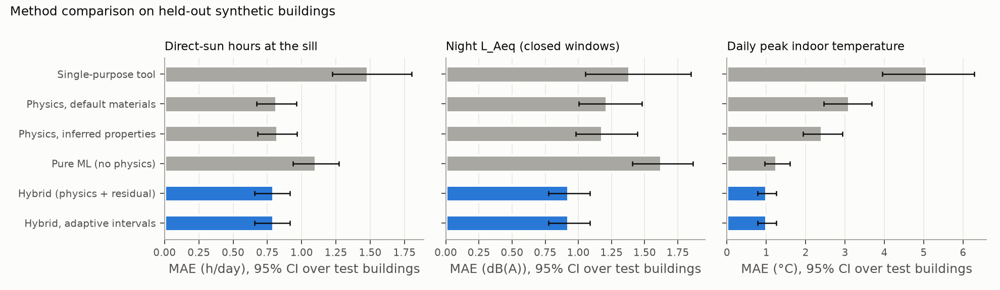
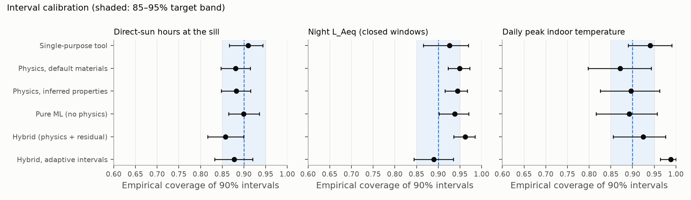
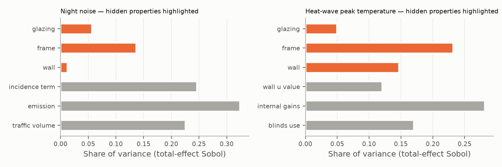
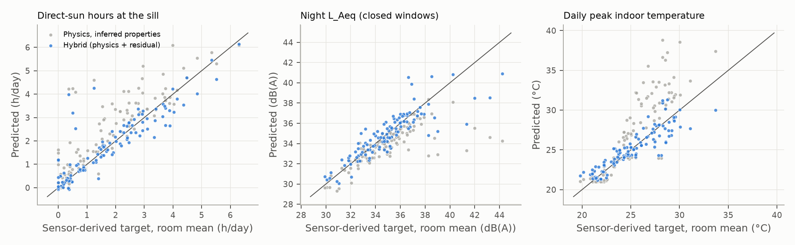
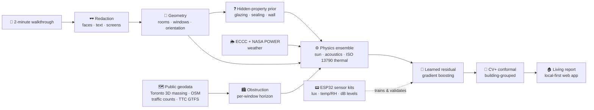

<div align="center">

# Dwell

### Know what a home feels like to *live* in — before you sign the lease.

**A 2-minute phone walkthrough + public geodata → per-room sunlight, night-time noise and summer heat,
each with an honest uncertainty range.**

[](https://github.com/eshaan2418/dwell/actions/workflows/ci.yml)


[The question](#the-question) ·
[Results](#results-so-far) ·
[How it works](#how-it-works) ·
[Sensor kit](#the-sensor-kit) ·
[Quick start](#quick-start) ·
[Rigor](#why-you-can-trust-the-numbers) ·
[Limitations](#what-dwell-is-not)

</div>

---

A listing tells you the square footage. It doesn't tell you that the bedroom gets no direct sun from
November to February, that the streetcar wakes you up when the window is open, or that the living room
hits the low thirties in a July heat wave. You find those out after you've moved in.

Dwell tries to tell you **before**. You film a short, slow pan of each room. Dwell combines that with
the city's 3D building massing, the street network, transit schedules and a decade of hourly weather, runs
fast physics simulators, corrects them with models trained on multi-week sensor measurements, and gives
every room a *living report* card:

| | What you get | How it's computed |
|---|---|---|
| ☀️ **Sun** | Direct-sun hours per day, month by month; sun patches on the floor on a date-and-hour slider | NREL solar position · ray casting through neighbouring buildings and trees · window apertures, reveals, overhangs |
| 🌙 **Night noise** | Night L_Aeq (23–07), windows closed and ajar, and a breakdown of how much is road and how much is transit | Road and transit source models → façade sound insulation from the *inferred* glazing → room |
| 🌡️ **Summer heat** | Daily peak indoor temperature for a typical summer and a heat wave; days with a peak above 26 °C and 28 °C | ISO 13790 5R1C thermal network with window solar gains, driven by Environment Canada weather |
| ❓ **What we couldn't see** | Which hidden properties (glazing, frame sealing, wall mass) drive the uncertainty, and by how much | Learned priors from visual cues + building age/type · Sobol variance decomposition |
| 🎧 **Night listen** | "Hear the bedroom at 2 am": an illustrative clip filtered by the predicted insulation | Source-class spectra × predicted façade transmission (clearly labelled as a synthesis, not a recording) |

Every number carries a **calibrated 90 % interval**, not a false-precision point estimate.

> [!IMPORTANT]
> **Honest status.** Every accuracy number on this page comes from **synthetic** apartments (a
> procedural generator plus simulated sensors). The real-home validation is fully built: firmware,
> calibration protocol, ingestion, frozen-split tooling and analysis. It is waiting on volunteer
> deployments ([`HUMAN_TODO.md`](HUMAN_TODO.md), [`DATA_STATUS.md`](DATA_STATUS.md)). Synthetic and
> real results are never blended into one headline number.

> [!WARNING]
> **Dwell is not an inspection.** It produces estimates with uncertainty. It is not a building
> inspection, a mould or structural assessment, or a legal disclosure.

---

## The question

> From a short phone walkthrough and public geodata, can a physics-informed learned model predict
> per-room daylight, night-time noise and peak summer temperature accurately enough, with calibrated
> uncertainty, to change a renter's decision, as validated against multi-week in-home sensor
> measurements?

The targets were set **before** any experiment ran: sun MAE ≤ 1 h, noise ≤ 3 dB, heat ≤ 1.5 °C,
and 90 % prediction intervals with 85–95 % empirical coverage.

## Results so far

Held-out **synthetic** buildings (32 test
buildings, frozen before any tuning; split by building, never by time).

| Target | Dwell hybrid MAE (95 % CI) | 90 % interval coverage | Target | Verdict (synthetic) |
|---|---|---|---|---|
| ☀️ Direct-sun hours/day at the main-window sill | **0.79 h** (0.66–0.92) | 86% | MAE ≤ 1 h | ✅ met |
| 🌙 Night L_Aeq 23–07, closed windows | **0.92 dB** (0.77–1.09) | 96% | ≤ 3 dB | ✅ met (see the mic-floor caveat) |
| 🌡️ Daily peak indoor temperature | **1.00 °C** (0.78–1.26) | 92% | ≤ 1.5 °C | ✅ met |

### Does the physics + learning combination earn its keep?

Each method is compared against every simpler alternative on the same held-out buildings (MAE; lower is
better):

| Method | ☀️ Sun (h/day) | 🌙 Noise (dB) | 🌡️ Heat (°C) |
|---|---|---|---|
| Single-purpose tool (sun path, no obstructions / city noise-map lookup / outdoor daily max) | 1.48 | 1.39 | 5.08 |
| Pure ML on geodata + scan features (no physics) | 1.10 | 1.62 | 1.25 |
| Physics, default materials | 0.82 | 1.21 | 3.10 |
| Physics, **inferred** hidden properties | 0.82 | 1.18 | 2.41 |
| **Dwell hybrid** (physics + learned residual + conformal) | **0.79** | **0.92** | **1.00** |

<p align="center"></p>

**How to read this:**

- **Heat** is where everything matters. Inferring the hidden properties cuts physics error from
  3.10 to
  2.41 °C, and the residual model brings it to
  1.00 °C. Removing hidden-property inference from the
  hybrid raises it to 1.57 °C.
- **Noise:** the hybrid beats both physics alone and pure ML, which is the worst method here
  (1.62 dB) because it has no model of façade
  insulation.
- **Sun** is mostly geometry. Physics alone is already close
  (0.82 h) and the residual adds little. The
  obstruction model is what matters: without neighbouring buildings and trees the hybrid degrades to
  1.03 h.

### Are the uncertainty intervals honest?

Dwell's intervals come from **CV+ conformal prediction grouped by building**, so a nominal 90 %
interval should contain the truth about 90 % of the time on buildings the model has never seen.

<p align="center"></p>

Coverage is also checked within groups (orientation, floor band, building age). It isn't uniform: for
example, sun coverage on south-facing rooms is
74% with marginal intervals and
85% with group-adaptive (Mondrian)
intervals. That's exactly the kind of gap the group tables in [`paper/paper.md`](paper/paper.md) are
there to expose.

### Seeing what the camera can't

Glazing type, frame sealing and wall construction are invisible in a video but drive noise and heat.
Dwell infers them from visual cues (pane reflections, low-E tint, frame material, radiators, wall
thickness at the reveal) plus building metadata, trained on 234
units and tested on 55 held-out ones:

| Hidden property | Default-materials guess | Dwell posterior | Without visual cues | Without building metadata |
|---|---|---|---|---|
| Glazing (single / double / low-E / triple) | 47% | **66%** | 58% | 62% |
| Wall construction | 64% | **96%** | | |

Accuracy alone isn't the point; the **posterior** is. Its uncertainty is pushed through the physics,
and a Sobol decomposition says how much of each prediction's variance comes from things we couldn't
see: **20%** for night noise and
**43%** for summer heat. The app turns that into
plain language ("most of the uncertainty in this bedroom's heat comes from not knowing the glazing").

<p align="center">
  
  
</p>

---

## How it works



**Three contributions** (positioned against the prior work in [`docs/PRIOR_WORK.md`](docs/PRIOR_WORK.md)):

1. **Inferring hidden properties from partial scans.** Learned priors over glazing, frame sealing and
   wall mass from visual cues and building metadata, with their errors propagated into every
   prediction by variance decomposition.
2. **Hybrid physics + learned residual models.** Fast simulators for sun, sound and heat, corrected by
   residual models trained on sensor measurements (simulated so far) and wrapped in building-grouped conformal intervals. Each
   is compared against physics-only, pure ML and single-purpose tools.
3. **Ground-truth validation in real homes.** A reusable, privacy-preserving sensor protocol and
   dataset design that compares predictions with weeks of lived conditions, plus a decision study
   asking whether a Dwell report actually changes which home people choose.

## The sensor kit

Predictions are only as good as what they're checked against, so Dwell ships its own validation
hardware: an **ESP32 + BH1750 (lux) + SHT31 (temp/RH) + INMP441 mic** kit, about $30–40, placed in
the bedroom and living room for 2–4 weeks.

- 🔇 **Privacy by construction.** The microphone feeds an on-device A-weighting filter and level
  statistics (1-s L_Aeq, per-minute L_Aeq / L_max / L_A90, octave bands). Audio samples never reach
  storage or the network, and a static checker in CI ([`firmware/tools`](firmware/tools)) fails the
  build if any code path could persist raw I²S samples.
- 🎯 **Verified DSP.** Host tests check the A-weighting against the IEC 61672 class-1 tolerance table,
  and the 1 kHz / 94 dB calibration path, octave bands and the energetic averaging.
- 🧪 **Calibration protocol.** A 24 h co-location of all kits for inter-kit agreement, a dB offset
  against a reference meter, and a lux sanity check against a clear-sky model.
- 📦 **Build it yourself.** Parts list, wiring, flashing and placement guide are in
  [`HUMAN_TODO.md`](HUMAN_TODO.md) and [`firmware/`](firmware/).

## The app

A **local-first** progressive web app ([`app/`](app/)): nothing goes to a cloud by default.

- **Capture:** a guided walkthrough with prompts ("pan slowly across each window") and a compass
  reading at each window.
- **Viewer:** a floor plan with room labels, a **sun slider** (date × hour) that moves sun patches
  across the floor, per-room report cards with uncertainty bands and "what we couldn't see",
  **side-by-side comparison** of two units, and the night-listen clip.
- The "not an inspection" disclaimer appears on every report.

`make demo` generates reports for two contrasting synthetic units plus a hypothetical unit on real
Toronto geodata, and builds the app. The slowest report took
302 seconds on a laptop CPU, inside the < 15 min budget. The
live demo script is in [`DEMO.md`](DEMO.md).

---

## Quick start

```bash
git clone https://github.com/eshaan2418/dwell.git && cd dwell
make setup            # uv venv + pinned dependencies
make test             # physics vs analytic cases, golden geometry, ingestion contract, privacy
make firmware         # ESP32 DSP host tests + no-raw-audio checker
make reproduce-quick  # synthetic world → every experiment → figures → number check
make demo             # living reports + app build
cd app && npm run dev # open the viewer
```

Requirements: Python 3.12 with [uv](https://docs.astral.sh/uv/), Node for the app, and optionally
[PlatformIO](https://platformio.org/) for `make firmware-build`. No GPU needed.

**Have real data?** Follow [`HUMAN_TODO.md`](HUMAN_TODO.md) (recruit, consent, build kits, calibrate,
deploy, film), then:

```bash
make ingest UNIT=U03       # raw kit logs → cleaned per-room targets
make recon UNIT=U03        # walkthrough → floor plan + windows
make freeze-test-units     # once ≥ three units exist; checksummed, never tuned on
make validate              # real-sensor evaluation, reported separately from synthetic
```

## Why you can trust the numbers

This repo is built so that it **cannot** quietly overclaim:

- 🔢 **Zero hand-typed numbers.** This README, the paper, the résumé bullets and the final review are
  *rendered* from templates. Every figure is pulled from a `results/` file stamped with git commit,
  data hash, seed and config. `make check-numbers` fails CI if any number on this page is stale or
  doesn't trace to a result (sidecar: [`README.md.numbers.json`](README.md.numbers.json)).
- 🏢 **Split by building, frozen early.** No random time splits within a unit. The test buildings were
  frozen with a checksum before modelling, and priors, residuals and conformal calibration never see
  them. Leave-one-building-out results are reported too.
- 📊 **The unit is the sample.** Confidence intervals bootstrap over buildings, not over minutes of
  sensor data.
- 🧱 **Ablations for everything:** no hidden-property inference, no residual, no obstruction model,
  no transit sources, no metadata, no geodata, no weather (see [`paper/paper.md`](paper/paper.md)).
- 🔐 **Privacy scanning.** `make privacy-scan` walks the *entire git history* for addresses, raw media,
  audio and credentials. Addresses and raw videos live only in the git-ignored `data/private/`.
- 🔁 **Reproducible from a clean clone.** `make reproduce-quick` regenerates every number and figure
  and checks them against the committed docs.

## Repository map

| Path | What's there |
|---|---|
| [`firmware/`](firmware/) | ESP32 sensor firmware, dB-only DSP, host tests, no-raw-audio checker |
| [`ingest/`](ingest/) | Kit logs → cleaned, time-aligned, calibrated per-room targets |
| [`recon/`](recon/) · [`semantics/`](semantics/) | Walkthrough → floor plan, windows, orientation · redaction |
| [`locate/`](locate/) | Geocoding, footprint snapping, OSM / Toronto massing, horizon profiles |
| [`physics/`](physics/) | `sun/` · `acoustics/` · `thermal/` simulators with analytic unit tests |
| [`hybrid/`](hybrid/) | Hidden-property priors, residual models, conformal intervals, Sobol, report generator |
| [`synth/`](synth/) | Procedural Toronto apartments + simulated multi-week sensor ground truth |
| [`bench/`](bench/) | Every experiment, figure and doc renderer |
| [`app/`](app/) | Local-first PWA: capture + viewer |
| [`study/`](study/) | Decision-study protocol, consent, randomisation, mixed-effects analysis (dry-run validated) |
| [`paper/`](paper/) · [`results/`](results/) | Draft paper · every number, with provenance ([`results/INDEX.md`](results/INDEX.md)) |
| [`release/`](release/) | De-identified room-level dataset tooling + datasheet (synthetic sample until consented real units exist) |

Project state lives in plain files: [`PROGRESS.md`](PROGRESS.md), [`DECISIONS.md`](DECISIONS.md),
[`BLOCKERS.md`](BLOCKERS.md), [`FINAL_REVIEW.md`](FINAL_REVIEW.md).

## What Dwell is not

**It's not an inspection, and it's not yet validated in real homes.** In particular:

- **Synthetic-only accuracy so far.** The simulator's assumptions are baked into these results; real
  homes will be messier. Real deployments starting in late autumn yield winter data first, so summer
  heat validation on real homes comes later.
- **The microphone floor.** MEMS mic self-noise dominates in quiet bedrooms. Only
  15 of 110
  held-out rooms are mostly above it, and on those rooms the hybrid MAE is
  2.52 dB. That's still within target but well above the
  headline. A class-2 meter subset is recommended.
- **Geometry fidelity is 2.5D** (floor plan + window boxes). Full 3D splatting needs a CUDA GPU this
  build didn't have, and there's no AR metric scale yet. On synthetic scans, window detection is the
  weakest link (recall
  44%).
- **The decision study is designed, not run.** Protocol, materials and analysis are ready and
  dry-run on simulated participants.

The strongest and weakest claims, threats to validity, and what a city-scale product would need are
in [`FINAL_REVIEW.md`](FINAL_REVIEW.md).

## Licences and attribution

Map data © OpenStreetMap contributors (ODbL). Contains information licensed under the Open Government
Licence – Toronto (3D Massing, traffic counts, TTC GTFS). Weather: Environment and Climate Change Canada
(Open Government Licence – Canada) and NASA POWER. Face-detection model: OpenCV Zoo YuNet.

<div align="center">
<sub>Built by Eshaan Kapooswalla · every number on this page is generated, not typed.</sub>
</div>
